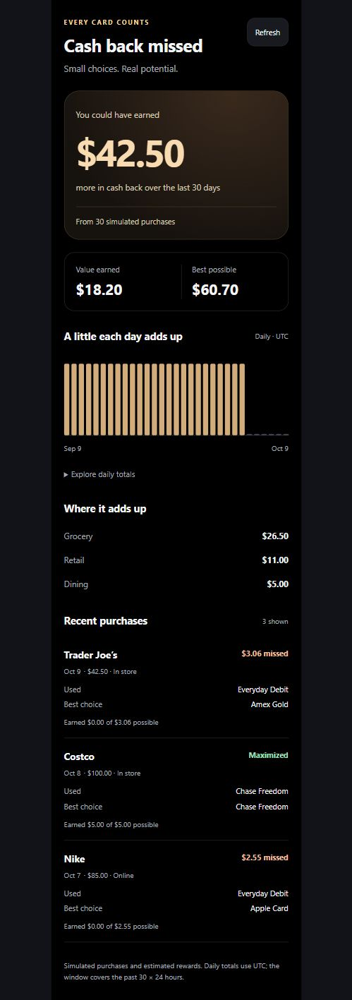

# Ayman: persistence and Missed

Owner: Ayman. Adapted to the shared contract during integration (Omar). The HTTP shapes are in [API.md](API.md); this file covers storage.

## Files

| File | Purpose |
|---|---|
| `backend/db.py` | `SQLiteStore`, `PostgresStore`, the `Database` facade, and the module interface `init()`, `mode()`, `get_db()` |
| `backend/migrations/002_transactions.*.sql` | Idempotent schema for SQLite and Postgres |
| `backend/persistence_models.py` | `Transaction` record (contract fields, integer cents), `IdempotencyConflict`, `DatabaseUnavailable` |
| `backend/transaction_service.py` | `record_purchase()`: resolve merchant → `engine.evaluate_purchase` → save once per idempotency key |
| `backend/seed.py` | 30 engine-computed demo purchases over the trailing 30 days, seeded once per database |
| `backend/routers/transactions.py`, `missed.py` | `POST /api/transactions`, `GET /api/missed` |
| `frontend/src/screens/missed/` | Rewards screen (the `missed` tab): earned, saved with codes, left on the table, streak, daily chart, history |

## Storage and configuration

The database is chosen **once, at startup**:

| `DATABASE_URL` | `ALLOW_SQLITE_FALLBACK` | Result (`db_mode`) |
|---|---|---|
| empty | any | SQLite at `SQLITE_PATH` (`sqlite`) |
| set, reachable, TimescaleDB installed | any | Tiger Data hypertable (`timescale`) |
| set, reachable, no TimescaleDB | any | Plain Postgres, `date_trunc` buckets (`postgres`) |
| set, unreachable | `false` (default) | **Startup fails** with a message naming the fix |
| set, unreachable | `true` | SQLite, clearly reported as `sqlite-fallback` |

After startup the database never switches. If a read or write fails, the API returns `503 database_unavailable` and does not claim anything was saved. Driver error text is never logged, because it can contain connection credentials.

- Money is stored as integer cents in both databases.
- Timestamps are UTC. SQLite stores fixed-precision ISO strings, so text order matches time order.
- Postgres: `transactions` is a hypertable on `ts` with primary key `(id, ts)`. A plain `transaction_requests` table enforces one row per `idempotency_key`, because hypertable unique keys must include `ts`.
- Daily buckets use `time_bucket('1 day', ts, 'UTC')` on Timescale.
- Tables from the pre-contract (v1) branch are renamed to `*_v1_legacy` on startup instead of being dropped.
- Seeding is tracked in `persistence_metadata` (`demo_seed_v2`), so restarts never duplicate the demo history, and it never mixes into a database that already has purchases.

## Verify

```powershell
cd backend
python -m pytest tests/test_persistence.py tests/test_persistence_api.py
# Opt-in, against a DISPOSABLE TimescaleDB database only:
$env:TEST_DATABASE_URL = "postgresql://..."; python -m pytest tests/test_tigerdata.py
cd ../frontend
npm test
```

## Rendered preview



i was here
